# TimeTo — ulepszona strona timeto.do

> Liczą się efekty, nie deklaracje.

To jest **ulepszona wersja strony [timeto.do](https://timeto.do)**, agencji performance marketingu z Gliwic.
Od razu uczciwie: **to nie jest idealna strona**. To AI slop: gradienty, glassmorphism, animacje przy
przewijaniu, „interaktywny symulator” i „live campaign monitor” z liczbami, które ładnie wyglądają.
Mimo to **jest lepsza niż obecna strona**: szybsza, czytelniejsza, z trybem ciemnym, działa na telefonie
i od pierwszego ekranu mówi, czym firma się zajmuje.

Technicznie to jednostronicowy landing w Next.js 16 (App Router) z dodatkową podstroną `/galeria`.
Bez backendu, bez bazy danych, bez CMS-a. Wszystkie treści są w kodzie komponentów.

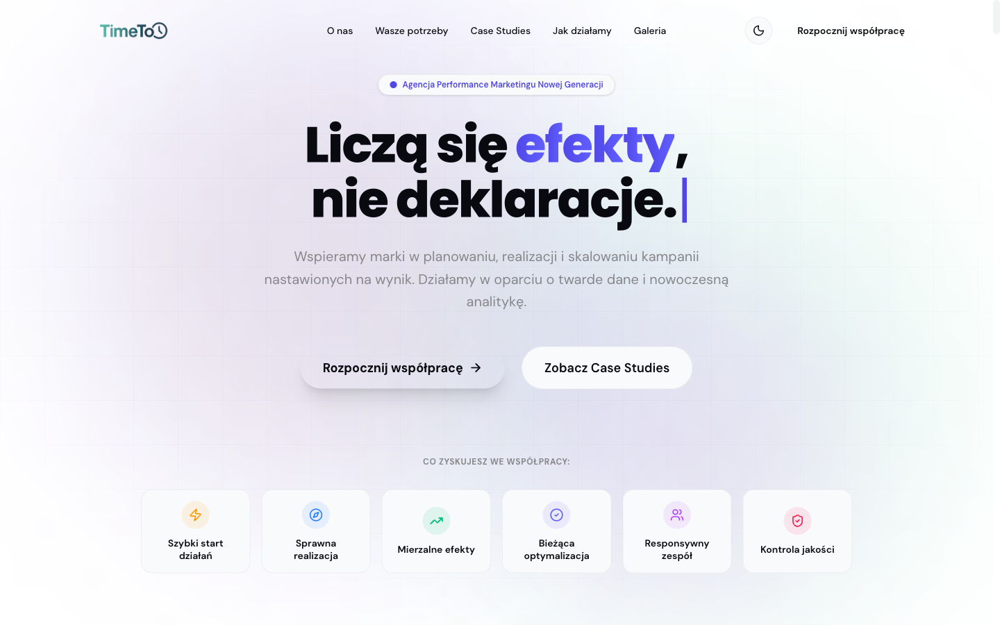

## Dla kogo

- **Dla zespołu TimeTo**, który chce zobaczyć, jak mogłaby wyglądać nowa strona, zanim ktoś zleci prawdziwy
  redesign. Można to kliknąć, przewinąć i pokazać na telefonie zamiast oglądać makiety.
- **Dla osoby, która będzie robić docelową stronę**. Układ sekcji, teksty i case studies są gotowym punktem
  wyjścia: wystarczy wziąć to, co działa, i wyrzucić resztę.

Czym to **nie jest**: nie jest to gotowa strona produkcyjna. Formularz niczego nie wysyła, kalkulator ROI
liczy na przykładowych współczynnikach, a liczby w „dashboardzie” są wpisane na sztywno. Szczegóły niżej,
w sekcji [Znane ograniczenia](#znane-ograniczenia).

## Co jest lepsze niż na obecnej stronie

- **Jasny przekaz od pierwszego ekranu**: hasło, jedno zdanie o tym, co robi agencja, dwa przyciski
  i sześć konkretnych korzyści.
- **Kanały pokazane osobno**: e-mail, SMS, display, push, call center, rich media, każdy z krótkim opisem.
- **Case studies z wynikiem w liczbach** (np. „300 transakcji / mc”, „1000+ kontaktów / mc”), przewijane
  poziomo, dziewięć branż.
- **Interaktywne elementy**: kalkulator ROI, wizualizacja przepływu ruchu, wieloetapowy formularz briefu.
- **Tryb jasny i ciemny** z zapamiętaniem wyboru w przeglądarce.
- **Wersja mobilna**: menu hamburger, układ jednokolumnowy, brak poziomego przewijania.
- **SEO**: metadane i Open Graph na każdej stronie, `canonical`, `sitemap.xml`, `robots.txt`, `lang="pl"`.

## Jak to działa

```
Przeglądarka ──► Next.js (App Router)
                   │
                   ├──► /            page.tsx  → HomeClient (wszystkie sekcje strony głównej)
                   ├──► /galeria     page.tsx  → GaleriaClient (orbita zdjęć, ślad za kursorem, masonry)
                   ├──► /sitemap.xml sitemap.ts
                   └──► /robots.txt  robots.ts
                           │
                     zdjęcia galerii ──► https://timeto.do/wp-content/uploads/… (obecna strona)
                     reszta grafik   ──► public/
```

Strony są renderowane statycznie. Metadane (`title`, `description`, Open Graph) są definiowane po stronie
serwera w `page.tsx`, a cała interaktywna część żyje w komponentach klienckich (`"use client"`).

Strona główna to jedna długa ścieżka, sekcja po sekcji:

1. **Hero** — hasło z efektem pisania, przyciski „Rozpocznij współpracę” i „Zobacz Case Studies”, korzyści.
2. **Marquee** — przewijany pasek z kanałami (e-mail, SMS, display, push, call center…).
3. **O nas + kanały** — opis agencji, animowany „Live campaign monitor”, karty kanałów dotarcia.
4. **Kalkulator ROI** — branża, budżet, kanały → leady, CPL, zwrot i projekcja na 6 miesięcy.
5. **Wasze potrzeby** — akordeon z wyzwaniami klientów i odpowiedzią TimeTo.
6. **Case studies** — przewijanie w dół przesuwa karty w poziomie (sticky + Framer Motion `useScroll`).
7. **Rurociąg konwersji** — animowany schemat: kanały → „TimeTo core” → konwersje.
8. **Jak działamy** — pięć filarów współpracy na osi czasu.
9. **FAQ** — najczęstsze pytania.
10. **Kontakt** — trzyetapowy kreator briefu (cele → kanały i budżet → dane), zespół, dane firmy.

## Funkcje

| Adres | Co to jest |
|---|---|
| `/` | Strona główna ze wszystkimi sekcjami opisanymi wyżej |
| `/#about`, `/#needs`, `/#cases`, `/#how-it-works`, `/#contact` | Kotwice używane w nawigacji |
| `/galeria` | Zdjęcia zespołu z konferencji i eventów: orbita zdjęć, ślad za kursorem, siatka masonry z powiększeniem |
| `/sitemap.xml`, `/robots.txt` | Generowane przez Next.js |

## Zrzuty ekranu

### Strona główna

| O nas i kanały dotarcia | Kalkulator ROI |
|---|---|
| 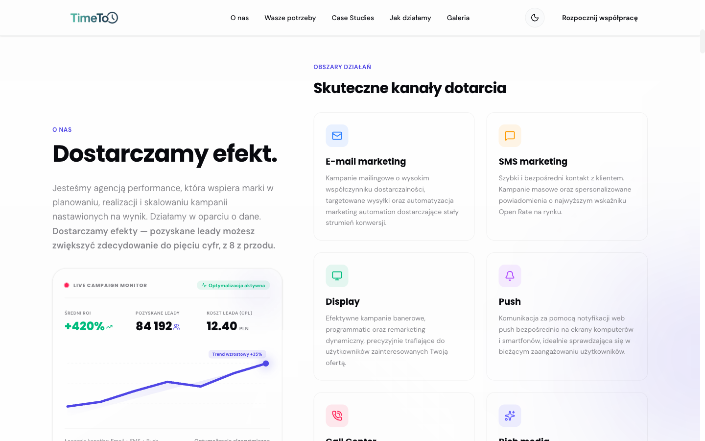 | 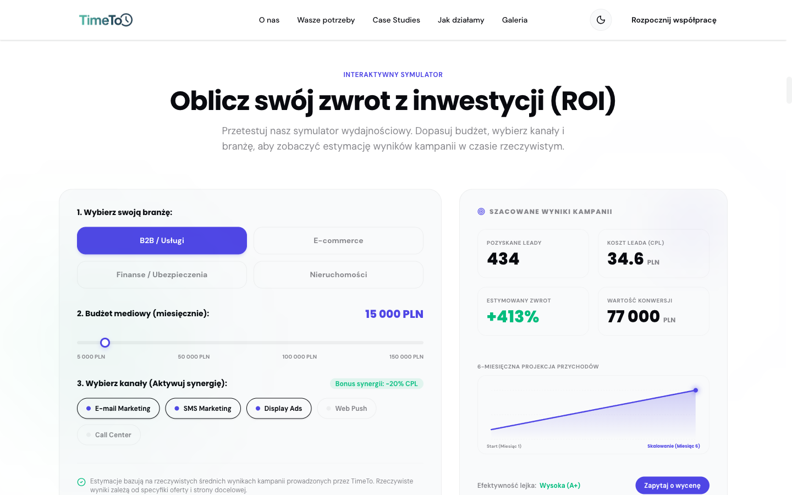 |

| Wasze potrzeby | Case studies |
|---|---|
| 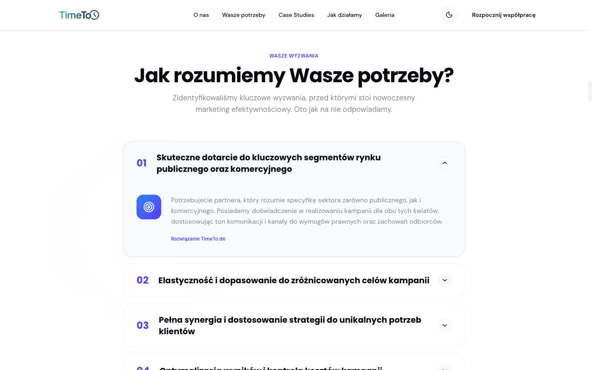 | 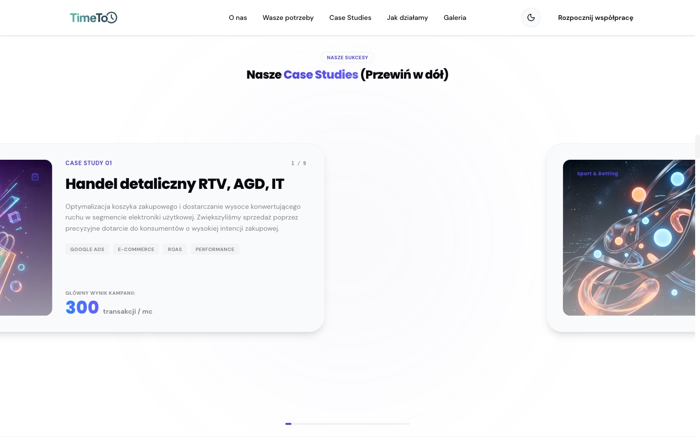 |

| Rurociąg konwersji | Jak działamy |
|---|---|
| 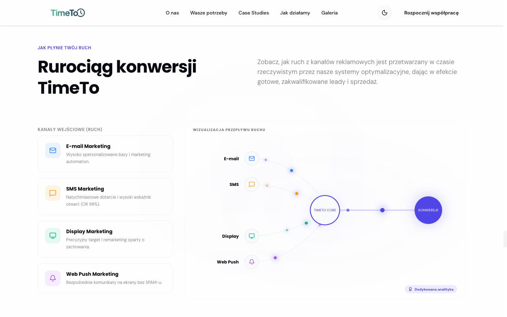 | 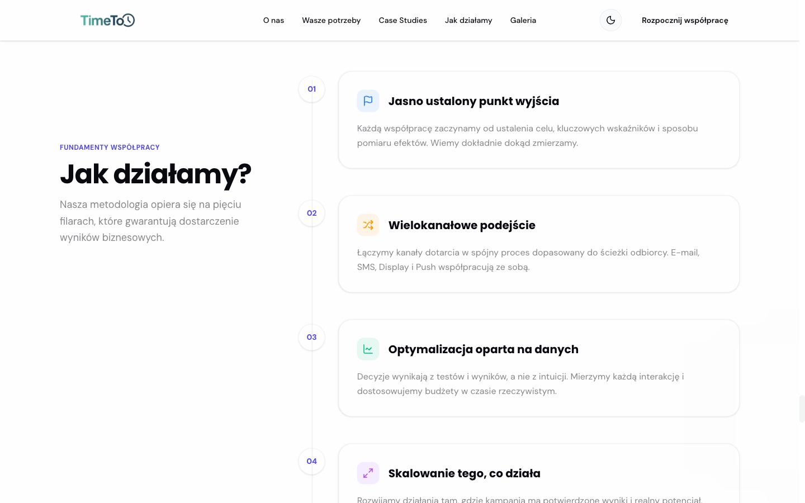 |

| FAQ | Kontakt i kreator briefu |
|---|---|
| 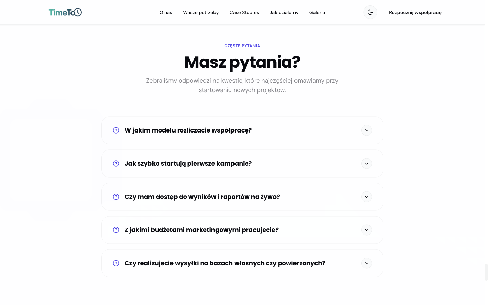 | 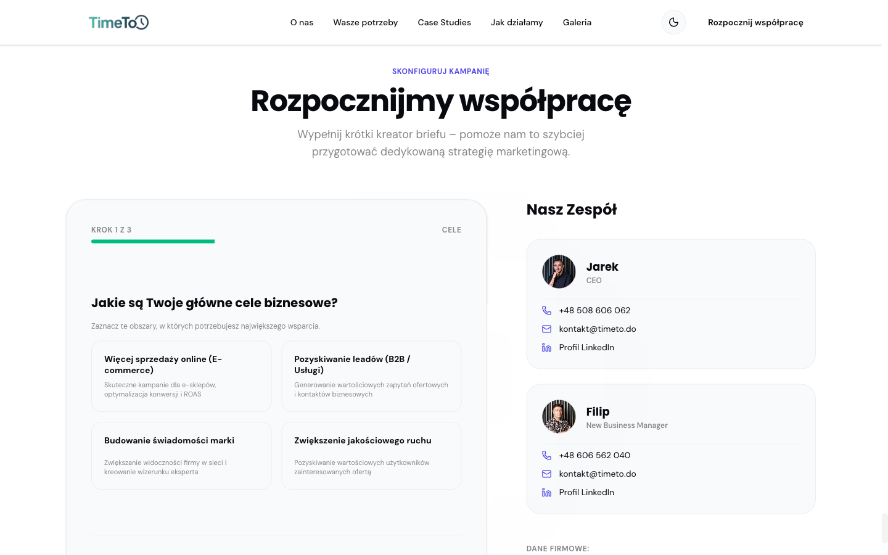 |

### Galeria

| Nagłówek z orbitą zdjęć | Galeria wspomnień |
|---|---|
| 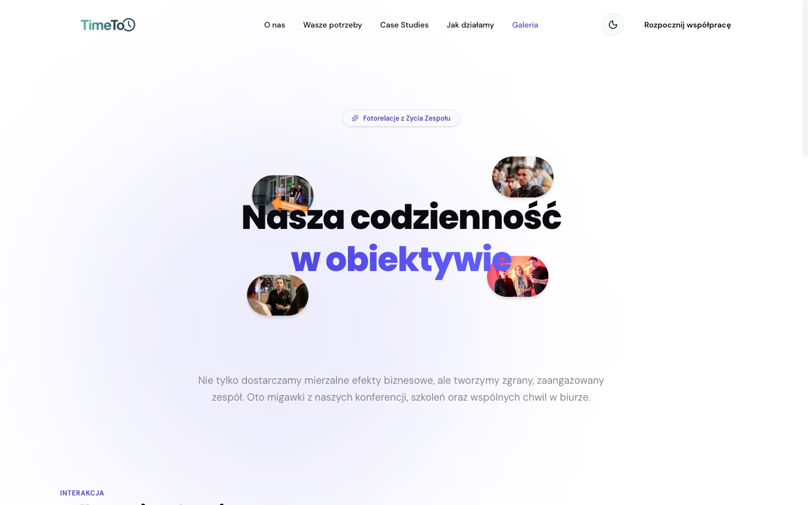 | 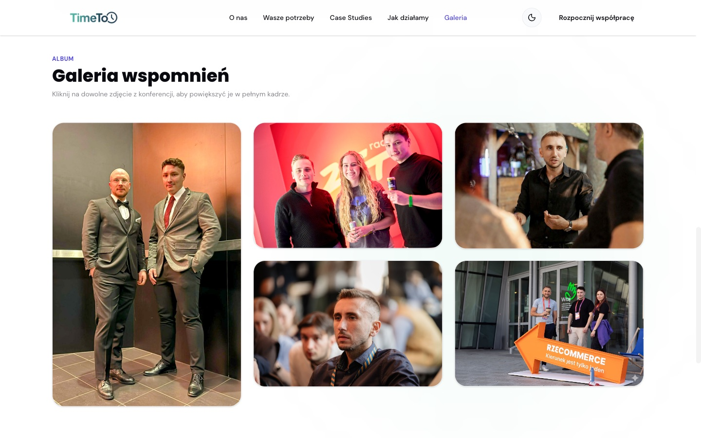 |

### Tryb ciemny

| Hero | Kalkulator ROI |
|---|---|
| 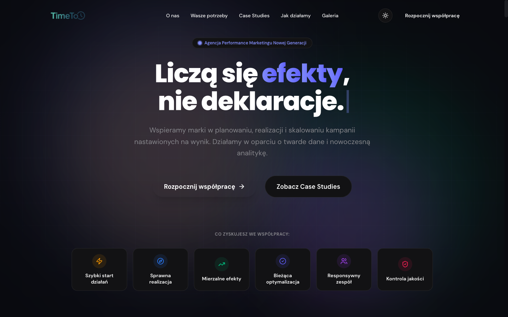 | 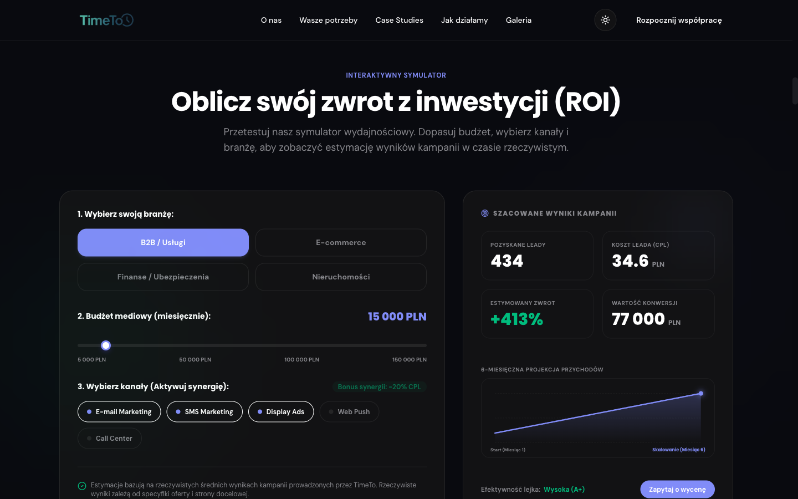 |

### Telefon

| Hero | Kalkulator ROI |
|---|---|
| 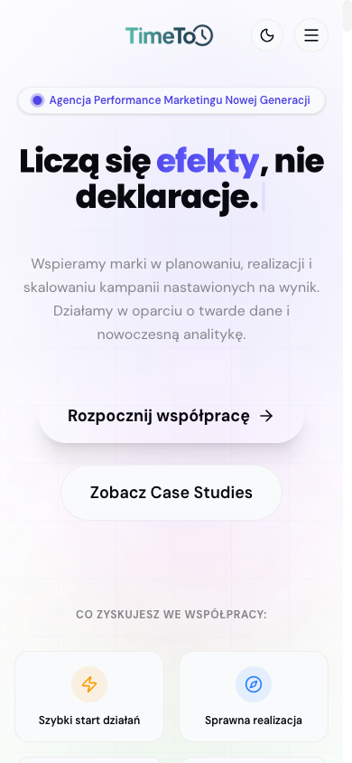 | 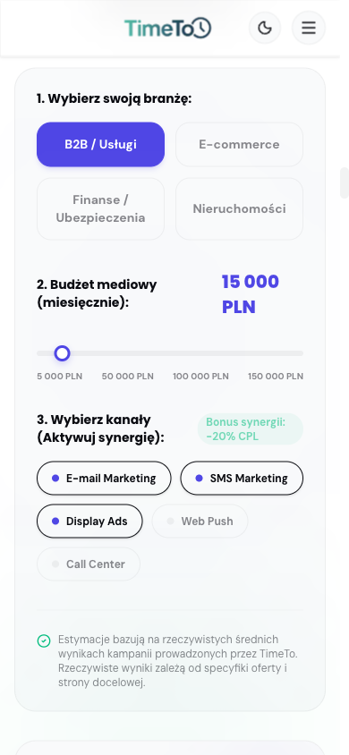 |

Zrzuty zrobione lokalnie (`npm run dev`) w rozdzielczości 1440×900 i 390×844.

## Uruchomienie

Wymagany Node.js 20.9 lub nowszy (wymóg Next.js 16).

```bash
npm install
npm run dev
```

Strona będzie pod adresem http://localhost:3000. Nie trzeba żadnych zmiennych środowiskowych ani pliku `.env`.

| Skrypt | Co robi |
|---|---|
| `npm run dev` | Serwer deweloperski z odświeżaniem na żywo |
| `npm run build` | Build produkcyjny |
| `npm start` | Serwer produkcyjny (po `build`) |
| `npm run lint` | ESLint |

Najprościej wdrożyć to na Vercelu: import repo i gotowe, bez dodatkowej konfiguracji.

## Stos technologiczny

| Co | Czym |
|---|---|
| Framework | Next.js 16 (App Router), React 19, TypeScript |
| Style | Tailwind CSS 4, kilka plików CSS dla komponentów galerii |
| Animacje | Framer Motion, GSAP |
| Ikony | lucide-react |
| Fonty | Poppins (nagłówki), DM Sans (tekst), przez `next/font` |

## Struktura

```
src/
  app/
    layout.tsx        fonty, globalne metadane, skrypt trybu ciemnego
    page.tsx          strona główna (metadane + HomeClient)
    galeria/page.tsx  galeria (metadane + GaleriaClient)
    sitemap.ts        sitemap.xml
    robots.ts         robots.txt
    globals.css       tokeny kolorów, tryb jasny i ciemny
  components/
    HomeClient.tsx    składa sekcje strony głównej w kolejności
    Navbar.tsx        nawigacja, przełącznik motywu, menu mobilne
    Hero.tsx, Marquee.tsx, AboutAndAreas.tsx, RoiCalculator.tsx, Needs.tsx,
    CaseStudies.tsx, TrafficPipeline.tsx, HowWeWork.tsx, FAQ.tsx, ContactForm.tsx
                      sekcje strony głównej
    GaleriaClient.tsx, OrbitImages.tsx, ImageTrail.tsx, Masonry.tsx
                      galeria
    InteractiveDashboard.tsx, ScrollReveal.tsx, TextType.tsx, Magnetic.tsx
                      efekty pomocnicze
public/
  logos/              logo TimeTo (kolor, białe, czarne)
  case_*.png          grafiki do case studies
  jarek.jpg, filip.jpg, office.jpg
docs/screenshots/     zrzuty ekranu do tego README
```

## Znane ograniczenia

To jest prototyp, więc przed wystawieniem go pod prawdziwy adres trzeba poprawić kilka rzeczy:

- **Formularz kontaktowy niczego nie wysyła.** Po kliknięciu „Wyślij Brief” jest tylko krótkie opóźnienie
  i komunikat o sukcesie. Trzeba go podpiąć pod mail, CRM albo choćby Formspree.
- **Kalkulator ROI to symulacja.** Liczy na przykładowych współczynnikach CPL, konwersji i wartości
  transakcji dla czterech branż, wpisanych w `RoiCalculator.tsx`. Przed publikacją trzeba je potwierdzić
  albo wyraźnie oznaczyć, że to szacunek.
- **„Live campaign monitor” nie jest na żywo.** Liczby (+420% ROI, 84 192 leady) są wpisane na sztywno.
- **Zdjęcia galerii są ładowane z obecnej strony** (`timeto.do/wp-content/…`). Gdy stara strona zniknie,
  zdjęcia znikną razem z nią, więc trzeba je przenieść do `public/`.
- **Tekst na stronie głównej nie daje się zaznaczyć** (`select-none` na `<main>`), więc nie da się
  na przykład skopiować numeru telefonu ani adresu.
- **Sporo efektów dla samych efektów.** Orbita zdjęć, ślad za kursorem, magnetyczne przyciski i „TimeTo core”
  w rurociągu niczego nie mówią klientowi. Warto część z nich wyrzucić.
- **Drobiazgi w kodzie**: `Preloader.tsx` nigdzie nie jest używany, a Framer Motion zgłasza w konsoli
  ostrzeżenie o przestarzałym `value.onChange`.
